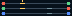

# Signal Box

Route three coloured trains through eight switchyards and beat your fewest-flips record.

Match the three incoming trains to the colours at the right edge. The back labels them A/B/C. Turn to select a pair of points, click to switch straight/crossed, and press Start to dispatch. Hold Start to reset the yard. Click after a win to advance. Personal bests and the current yard survive restart.

## Run locally

From this folder, run `~/.busy-emulator/bin/busy-emulator dev --once` with BUSY Bar Emulator open. Back exits.

[Watch the controls on firmware](media/controls.mp4)
