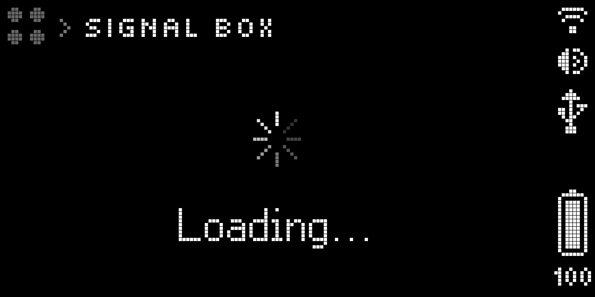
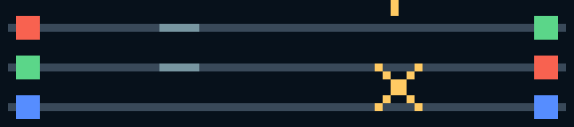

# Signal Box

Route three coloured trains through eight switchyards and beat your fewest-flips record.

Three trains leave together. Before dispatch, trace each colour through the points to the matching platform. The rear panel labels the target order A/B/C, which also gives you a way to check the puzzle when the colours are hard to distinguish.

## Screen transitions

Follow the switch across the track diagram, then watch the train take the selected route.


<details>

<summary>Watch the rear display</summary>



</details>

## Change the route

1. Read the incoming trains on the left and the destination colours on the right.
2. Turn the wheel to move the selection between pairs of points. The highlighted pair is the one the click will change.
3. Click the wheel to switch that pair between straight and crossed. Trace the other two paths again before you send the trains.


## Dispatch and check the platforms

1. Press **Start** after setting the points. Watch the three train markers travel across the front together.
2. Check the arrival order against the target. If it is wrong, change the route and try another dispatch. Hold **Start** to reset the yard.
3. After a successful dispatch, click to advance. There are eight yards, and the fewest-flips record gives you a reason to replay one.



## Keeping a record

Signal Box saves the current yard and personal bests on the device. A route that matches all three destinations completes the puzzle even if you can solve it later with fewer flips. All eight yards were solved in the emulator, including a three-flip result on the final yard.

## Run in the emulator

Open BUSY Bar Emulator. From this repository, run:

```sh
~/.busy-emulator/bin/busy-emulator dev --once
```

Press **Back** to exit.

The GIFs are excerpts from the emulator recording. Each LED occupies a 16 × 16 cell with a black border. The last frame pauses for reading.

[Full recording](media/controls.mp4) · [Rear display](screenshots/back-1.png) · [Firmware test](EMULATOR-QA.md) · [MIT license](LICENSE)
